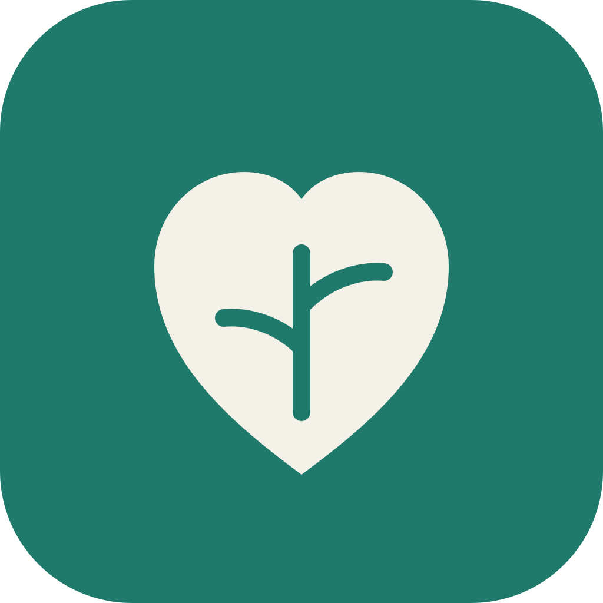
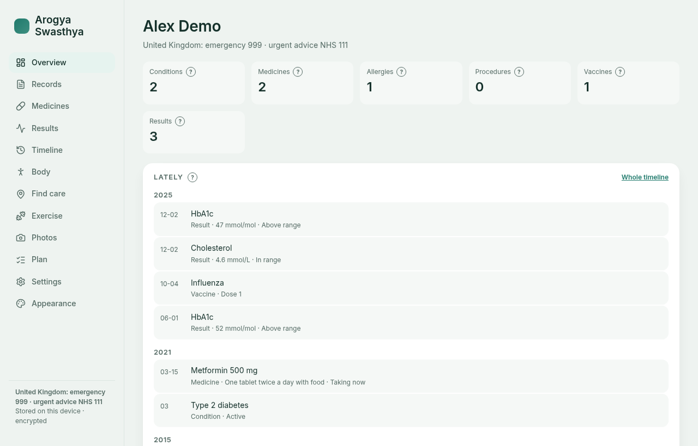
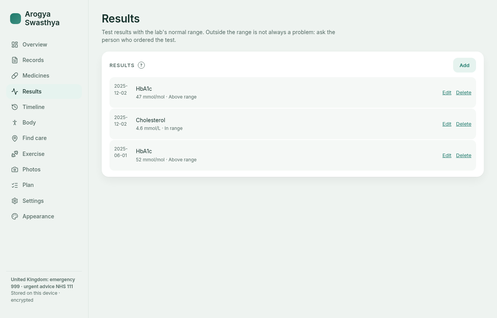
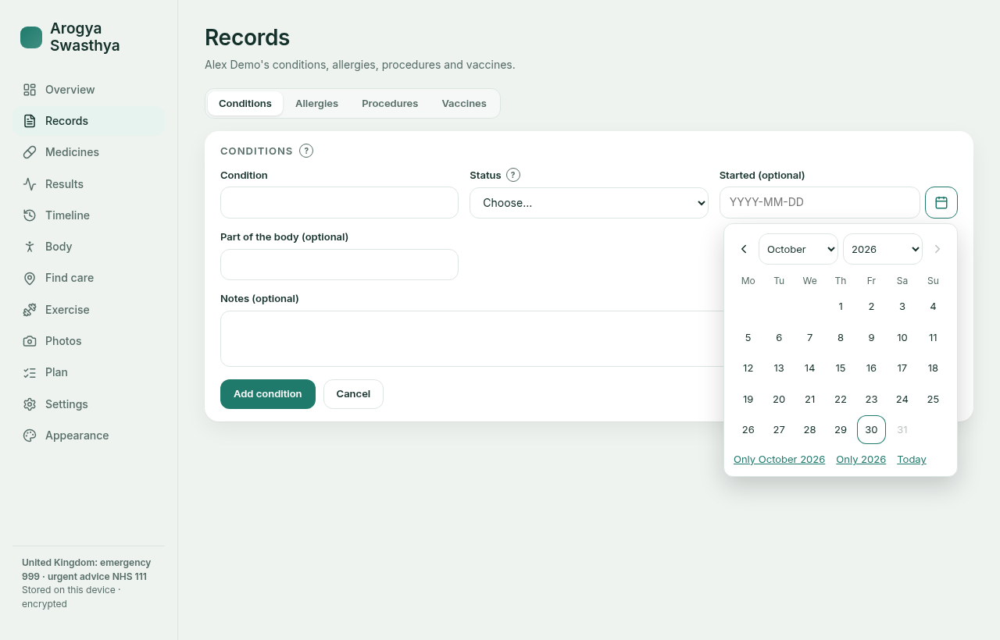
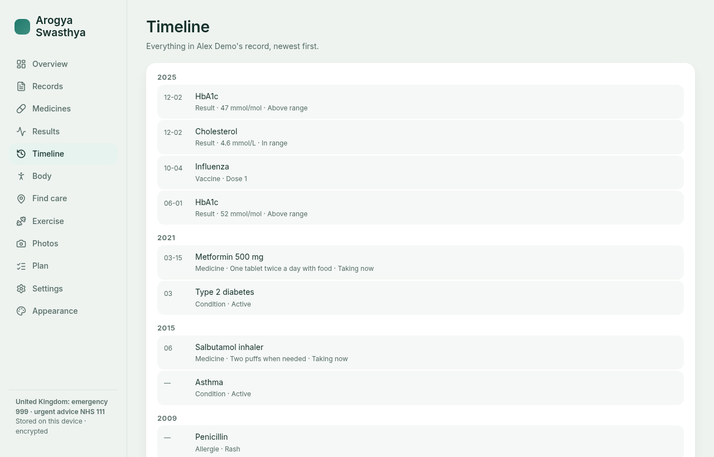
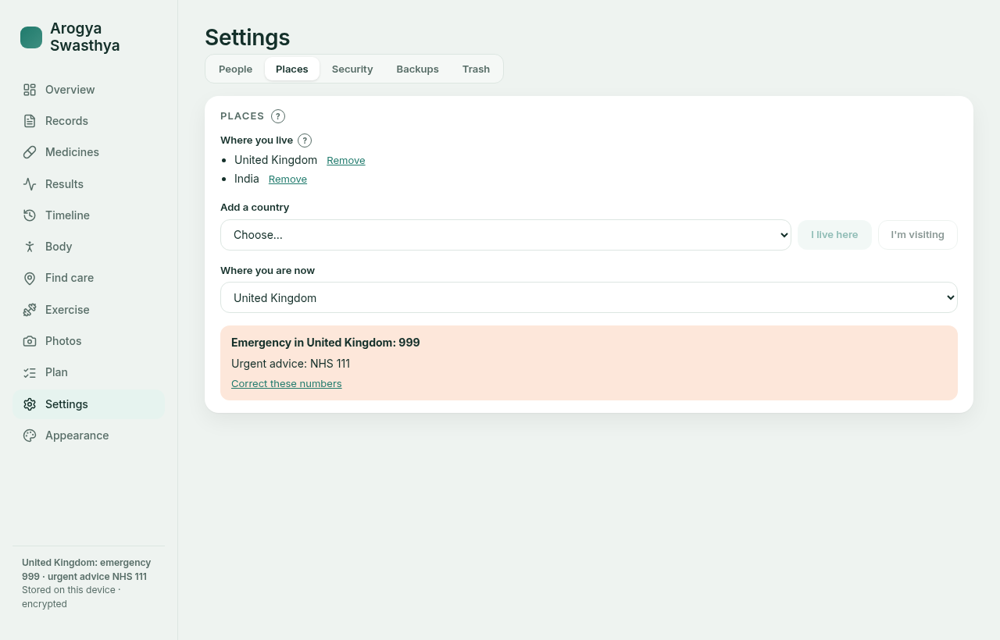
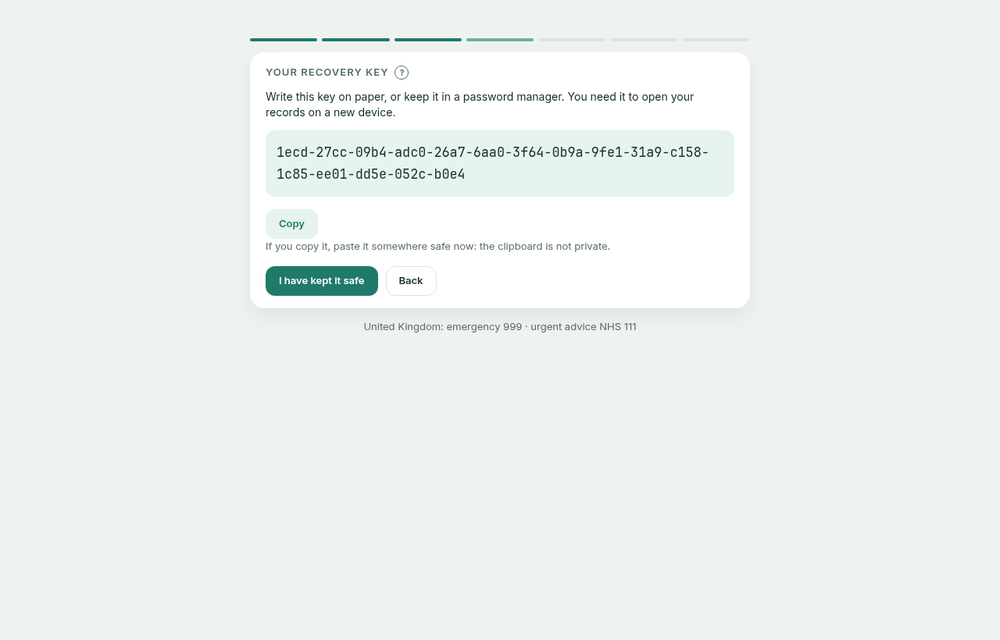
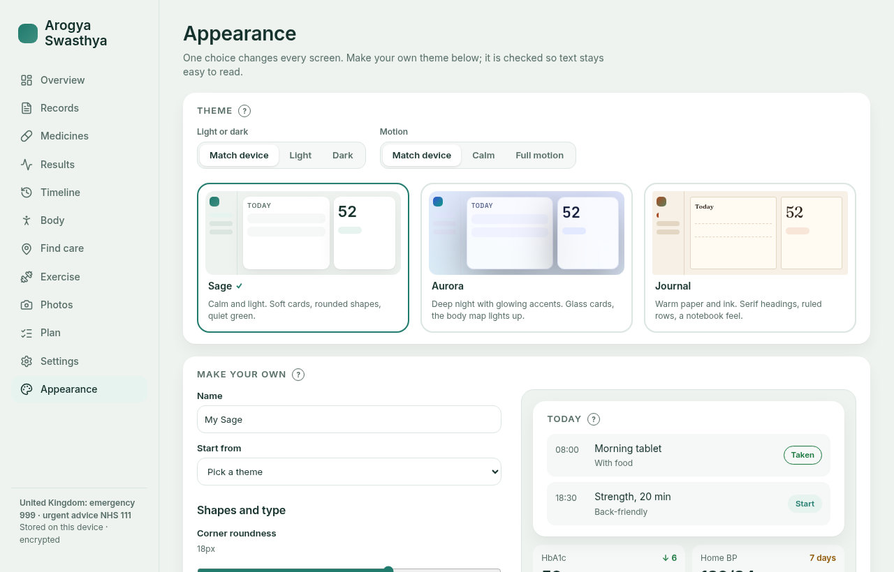
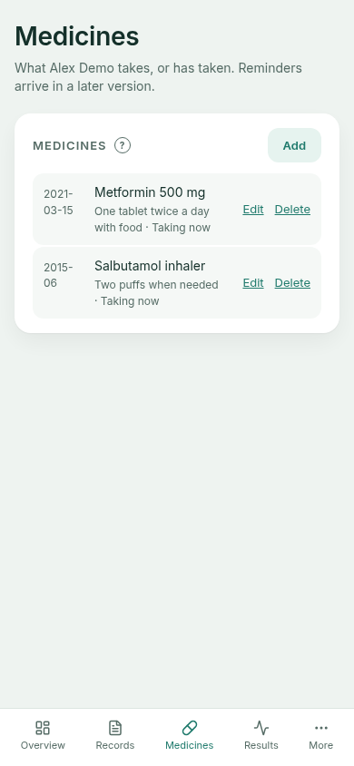
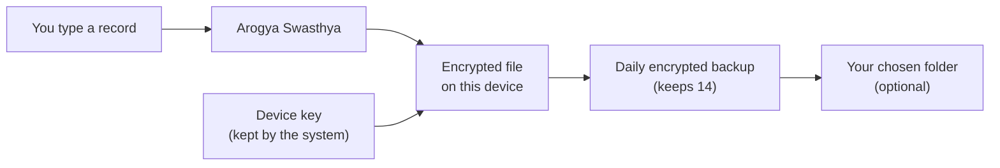

<h1 align="center">
  <br>
  <a href="https://github.com/sudharamachandranrajeev/arogya-swasthya"></a>
  <br>
  Arogya Swasthya
  <br>
</h1>

<h4 align="center">Keep your health records, and your family's, private and in one place for life.</h4>

<p align="center">
  
  
  
</p>

<p align="center">
  <a href="#-what-it-does">What it does</a> •
  <a href="#-get-started">Get started</a> •
  <a href="#-how-it-works">How it works</a> •
  <a href="#-faq-and-troubleshooting">FAQ</a> •
  <a href="#%EF%B8%8F-for-developers">For developers</a>
</p>

<p align="center">
  
</p>

*Ārogya svāsthya* is Sanskrit for "freedom from illness, being well in oneself". This app is for
anyone who wants their own copy of their medical history: conditions, medicines, allergies,
procedures, vaccines and test results, for themselves and for the people they look after.
Status: **early development**. There is no download yet, and the records screens are the first
part to be built.

## ✨ What it does

- 🗂️ **All your records in one place** – conditions, medicines, allergies, procedures, vaccines
  and test results, typed in your own words with suggestions as you go.
- 👨‍👩‍👧 **Records for the whole family** – add a parent, a child or anyone you care for, and switch
  between them.
- 🧪 **Test results that make sense** – copy the lab's normal range and the app shows whether
  each result is in range.
- 📅 **Dates the way you remember them** – pick a day from a calendar, or just a month or a year
  ("asthma since 2015").
- 🚑 **Emergency numbers where you are** – follows the country you live in, or the one you are
  visiting today.
- 🔒 **Encrypted, on your device only** – nothing is sent anywhere. A PIN, fingerprint or face
  can lock the app.
- 💾 **Daily backups and a 30-day trash** – a deleted record can come back, and **Undo** fixes
  a slip at once.
- 🎨 **Three looks, light or dark** – Sage, Aurora and Journal, a calm mode with less motion,
  or make your own.

Coming in later versions: reminders, a 3D body map, finding care near you, exercise plans,
photo series, care plans and optional AI help.

## 📸 Screenshots

<table>
  <tr>
    <td></td>
    <td></td>
    <td></td>
  </tr>
  <tr>
    <td align="center">Results with the lab's range</td>
    <td align="center">Calendar for any date</td>
    <td align="center">Timeline</td>
  </tr>
  <tr>
    <td></td>
    <td></td>
    <td></td>
  </tr>
  <tr>
    <td align="center">Places and emergency numbers</td>
    <td align="center">Recovery key at setup</td>
    <td align="center">Themes</td>
  </tr>
</table>

<p align="center"></p>

All screenshots use made-up demo data.

## 🚀 Get started

> [!NOTE]
> There is no release yet. Installers for Windows, Linux and Android will be on the
> [releases page](https://github.com/sudharamachandranrajeev/arogya-swasthya/releases) when the
> first version is ready. Until then, you can [build it yourself](#%EF%B8%8F-for-developers).

The first time you open the app, a short setup (about two minutes) asks you to:

1. **Choose where you live.** Add each country if you split your year. This sets the emergency
   numbers.
2. **Read and accept the terms.** The app keeps records; it does not diagnose.
3. **Write down your recovery key.** It is shown once. The app then asks you to type one part of
   it back, to check.
4. **Set a PIN** (optional). On a phone you can also use your fingerprint or face.
5. **Choose a backup folder** (optional, on a computer). A USB drive or a synced cloud folder
   keeps a second copy safe.
6. **Add the first person.** Usually you.

## 🧭 How it works



- Records are stored in the format hospitals use to exchange data (FHIR R4), so they can move to
  and from other health systems later.
- The file is encrypted with a random key. Your computer's keyring or your phone's secure
  keystore holds that key. The recovery key is your own copy of it.
- Nothing leaves the device. Later versions will ask before sending anything, and show you what
  they would send.

## 🔒 Your data

- **Where it lives:** in the app's own folder on your device, encrypted. Only your account can
  open that folder.
- **What leaves the device:** nothing.
- **Backups:** one a day, the newest 14 kept, in the app's folder and in your chosen folder.
  **Settings → Backups → Save a backup as…** saves one anywhere you like.
- **Deleting:** deleted records go to **Settings → Trash** for 30 days, then are removed for
  good. Deleting a person moves all their records too.

> [!IMPORTANT]
> Keep your recovery key safe. If you move to a new device or reinstall the system, the recovery
> key is the only way to open your records or your backups. Nobody can reset it.

## ❓ FAQ and troubleshooting

<details>
<summary><b>I forgot my PIN</b></summary>

On the lock screen, choose to use your recovery key instead. After five wrong PINs the app makes
you wait 30 seconds, and the wait doubles each time, up to 15 minutes.
</details>

<details>
<summary><b>I lost my recovery key</b></summary>

If the app still opens on this device, go to **Settings → Security → Show recovery key** and
write it down again. If the device itself is lost, the records cannot be opened without the key.
</details>

<details>
<summary><b>Does the app tell me what is wrong with me?</b></summary>

No. It keeps your records and shows whether a result is inside the range the lab printed.
Outside the range is not always a problem: ask the person who ordered the test.
</details>

<details>
<summary><b>My country's emergency number is wrong</b></summary>

Go to **Settings → Places** and choose **Correct these numbers**. Your numbers replace the
built-in ones on every screen.
</details>

<details>
<summary><b>Can I use it for my parents or children?</b></summary>

Yes. Add them in **Settings → People**. Each person's records are kept apart, and you switch
between them there.
</details>

## 🛠️ For developers

<details>
<summary><b>Build from source, tests and screenshots</b></summary>

You need [mise](https://mise.jdx.dev) (it installs the pinned Rust, Java and gitleaks), Node 24,
and the [Tauri prerequisites](https://v2.tauri.app/start/prerequisites/) for your system.

```bash
git clone https://github.com/sudharamachandranrajeev/arogya-swasthya
cd arogya-swasthya
mise install
npm install

npm run dev                    # browser preview, records live in memory only
cd app && mise exec -- npx tauri dev      # the desktop app
```

Checks, as CI runs them:

```bash
npm run check && npm test                       # types, theme contrast, model tests
mise exec -- cargo fmt --all --check
mise exec -- cargo clippy --workspace --all-targets -- -D warnings
mise exec -- cargo test --workspace             # encrypted store, backups, PIN lockout
```

Android (needs the Android SDK and NDK; set `ANDROID_HOME` and `NDK_HOME`):

```bash
cd app
mise exec -- npx tauri android init --ci
mise exec -- npx tauri android build --debug --apk --target aarch64 --ci
```

Screenshots in `docs/screenshots` come from made-up data in the browser preview. Start
`npm run dev`, then run `node scripts/screenshots.mjs` (set `CHROMIUM` if Chromium is not at
`/usr/bin/chromium`).

Layout: `core/` is the Rust record store, `app/` the Tauri and Svelte app, `ui/` the theme
framework, `plugins/device/` the key storage plugin for phones.
</details>

<details>
<summary><b>Credits</b></summary>

- [Tauri](https://tauri.app), [Svelte](https://svelte.dev) and [Rust](https://www.rust-lang.org)
- [SQLCipher](https://www.zetetic.net/sqlcipher/) through [rusqlite](https://github.com/rusqlite/rusqlite)
- [HL7 FHIR R4](https://hl7.org/fhir/R4/) for the record format
- [Lucide](https://lucide.dev) icons
- [Inter](https://rsms.me/inter/), [Fraunces](https://github.com/undercasetype/Fraunces),
  [Space Grotesk](https://github.com/floriankarsten/space-grotesk) and
  [JetBrains Mono](https://www.jetbrains.com/lp/mono/) fonts
</details>

## License

[MIT](LICENSE)

---

> GitHub [@sudharamachandranrajeev](https://github.com/sudharamachandranrajeev)
