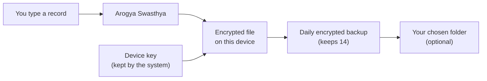

<h1 align="center">
  <br>
  <a href="https://github.com/sudharamachandranrajeev/arogya-swasthya"></a>
  <br>
  Arogya Swasthya
  <br>
</h1>

<h4 align="center">Keep your health records, and your family's, private and in one place for life.</h4>

<p align="center">
  
  
  
</p>

<p align="center">
  <a href="#-what-it-does">What it does</a> •
  <a href="#-get-started">Get started</a> •
  <a href="#-how-it-works">How it works</a> •
  <a href="#-faq-and-troubleshooting">FAQ</a> •
  <a href="#%EF%B8%8F-for-developers">For developers</a>
</p>

<p align="center">
  
</p>

*Ārogya svāsthya* is Sanskrit for "freedom from illness, being well in oneself". This app is for
anyone who wants their own copy of their medical history: conditions, medicines, allergies,
procedures, vaccines and test results, for themselves and for the people they look after.
Status: **alpha**. The records screens, backups and updates work; the features listed under
"Coming in later versions" do not exist yet.

## ✨ What it does

- 🗂️ **All your records in one place** – conditions, medicines, allergies, procedures, vaccines
  and test results, typed in your own words with suggestions as you go.
- 👨‍👩‍👧 **Records for the whole family** – add a parent, a child or anyone you care for, and switch
  between them.
- 📎 **Documents, encrypted** – keep letters, reports, scans, photos and recordings with each
  person, each file encrypted with its own key.
- 🔎 **Search everything** – records, the words in PDFs, and (if you allow it) the words in
  photos, scans and recordings, read on your device.
- 📥 **Bring your records in** – open a FHIR, NDJSON or IPS file, a C-CDA document from a hospital
  portal, or a SMART Health Link. You see every record and tick the ones to keep; ones you
  already have are marked. One **Undo** takes the whole import back.
- 💓 **Track how you are** – put in blood pressure, pulse, weight, blood sugar and other readings
  together, and rate symptoms from 0 to 10.
- 📈 **Trends** – a chart for each reading, result and symptom, with the lab's normal range
  shaded and a table view. **Patterns** shows readings that changed together, how sure it is,
  and that this does not show a cause.
- ⏰ **Medicine reminders** – add the times to a medicine and the app reminds you, and once more
  30 minutes later if the dose is not marked. Quiet hours, and reminders say only "Time for a
  medicine" unless you choose to show names. Marking a second dose within two hours asks first.
- 🧮 **Calculators** – BMI, waist to height, kidney function (eGFR), pack-years and alcohol
  units, filled in from your records, each showing its formula and source.
- 🩺 **Doctor report** – choose what to share and the period, add a note, and save a PDF for an
  appointment. Made on the device.
- 📤 **Take your records anywhere** – save a patient summary (IPS) other health apps and clinics
  can read, or every record as a FHIR file.
- 🧪 **Test results that make sense** – copy the lab's normal range and the app shows whether
  each result is in range.
- 📅 **Dates the way you remember them** – pick a day from a calendar, or just a month or a year
  ("asthma since 2015").
- 🚑 **Emergency numbers where you are** – follows the country you live in, or the one you are
  visiting today.
- 🔒 **Encrypted, on your device only** – nothing is sent anywhere. A PIN, fingerprint or face
  can lock the app.
- 💾 **Daily backups and a 30-day trash** – a deleted record can come back, and **Undo** fixes
  a slip at once. Before restoring a backup, the app shows what it holds.
- 🔄 **Safe updates** – the app asks before updating, backs up your records first, and can go
  back to the version before.
- 🎨 **Three looks, light or dark** – Sage, Aurora and Journal, a calm mode with less motion,
  or make your own.

Coming in later versions: a 3D body map, finding care near you, exercise plans,
photo series, care plans and optional AI help.

## 📸 Screenshots

<table>
  <tr>
    <td></td>
    <td></td>
    <td></td>
  </tr>
  <tr>
    <td align="center">Results with the lab's range</td>
    <td align="center">Calendar for any date</td>
    <td align="center">Timeline</td>
  </tr>
  <tr>
    <td></td>
    <td></td>
    <td></td>
  </tr>
  <tr>
    <td align="center">Places and emergency numbers</td>
    <td align="center">Recovery key at setup</td>
    <td align="center">Themes</td>
  </tr>
</table>

<p align="center"></p>

All screenshots use made-up demo data.

## 🚀 Get started

Download from the
[latest release](https://github.com/sudharamachandranrajeev/arogya-swasthya/releases/latest).
Pick the file for your device:

| Device | File | How to install |
| --- | --- | --- |
| Windows 10 or 11 | `Arogya.Swasthya_<version>_x64-setup.exe` | Run it. No admin rights needed. |
| Windows, no install | `ArogyaSwasthya_<version>_x64_portable.zip` | Unzip anywhere and run `arogya-swasthya.exe`. |
| Linux (most) | `Arogya.Swasthya_<version>_amd64.AppImage` | Make it executable (`chmod +x`), then run it. |
| Arch Linux | `arogya-swasthya-<version>-1-x86_64.pkg.tar.zst` | `sudo pacman -U` the file. |
| Android 7 or later | `ArogyaSwasthya_<version>_aarch64.apk` | Open it on the phone and allow installing from your browser or files app. |

Windows may say the program is from an unknown publisher: choose **More info**, then
**Run anyway**. The program is not signed with a paid Windows certificate.

**Check the download (optional).** Each release has a `SHA256SUMS.txt` file. Compare its line
for your file with the result of:

```bash
sha256sum Arogya.Swasthya_0.1.0_amd64.AppImage      # Linux
certutil -hashfile Arogya.Swasthya_0.1.0_x64-setup.exe SHA256   # Windows
```

If the two do not match, do not run the file: download it again.

The first time you open the app, a short setup (about two minutes) asks you to:

1. **Choose where you live.** Add each country if you split your year. This sets the emergency
   numbers.
2. **Read and accept the terms.** The app keeps records; it does not diagnose.
3. **Write down your recovery key.** It is shown once. The app then asks you to type one part of
   it back, to check.
4. **Set a PIN** (optional). On a phone you can also use your fingerprint or face.
5. **Choose a backup folder** (optional, on a computer). A USB drive or a synced cloud folder
   keeps a second copy safe.
6. **Choose whether to check for new versions.** The app asks before installing anything.
7. **Add the first person.** Usually you.

## 🧭 How it works



- Records are stored in the format hospitals use to exchange data (FHIR R4), so they can move to
  and from other health systems later.
- The file is encrypted with a random key. Your computer's keyring or your phone's secure
  keystore holds that key. The recovery key is your own copy of it.
- Your records never leave the device. The only thing the app sends is the update check, which
  you can turn off.

## 🔒 Your data

- **Where it lives:** in the app's own folder on your device, encrypted. Only your account can
  open that folder.
- **What leaves the device:** no records, ever. If you allow it, the app asks GitHub once at
  start whether a new version is out (GitHub sees your internet address, nothing else).
- **What the app downloads, only when you say yes:** the reading model for photos and scans
  (about 12 MB, from the ocrs project) and the speech model for recordings (about 60 MB, from
  Hugging Face, desktop only). Each is checked against a fixed fingerprint. Opening a SMART
  Health Link fetches the records from the server named in the link; they arrive encrypted and
  are decrypted on your device.
- **Reminders:** set up on the device by the app; nothing is sent to a server. A reminder says
  only "Time for a medicine" unless you turn on names in **Medicines → Today**.
- **Exports and reports:** a doctor report or an export saved with **Settings → Export** is a
  normal file, not encrypted. Keep it somewhere private, and delete it when it is no longer
  needed.
- **Backups:** one a day, the newest 14 kept, in the app's folder and in your chosen folder.
  One more before each update (the newest 3 kept) and before each restore.
  **Settings → Backups → Save a backup as…** saves one anywhere you like.
- **Deleting:** deleted records go to **Settings → Trash** for 30 days, then are removed for
  good. Deleting a person moves all their records too.

> [!IMPORTANT]
> Keep your recovery key safe. If you move to a new device or reinstall the system, the recovery
> key is the only way to open your records or your backups. Nobody can reset it.

## ❓ FAQ and troubleshooting

<details>
<summary><b>I forgot my PIN</b></summary>

On the lock screen, choose to use your recovery key instead. After five wrong PINs the app makes
you wait 30 seconds, and the wait doubles each time, up to 15 minutes.
</details>

<details>
<summary><b>I lost my recovery key</b></summary>

If the app still opens on this device, go to **Settings → Security → Show recovery key** and
write it down again. If the device itself is lost, the records cannot be opened without the key.
</details>

<details>
<summary><b>Does the app tell me what is wrong with me?</b></summary>

No. It keeps your records and shows whether a result is inside the range the lab printed.
Outside the range is not always a problem: ask the person who ordered the test.
</details>

<details>
<summary><b>How do I restore a backup?</b></summary>

Go to **Settings → Backups → Restore a backup**. Pick a backup from the list, or **Use a file
instead** for one you saved elsewhere. The app shows how many records it holds, for whom, and the
date of its last change, before anything is replaced. Your records as they are now are backed
up first, so you can undo a restore the same way.

A backup made on another device opens only with that device's recovery key. The app asks for it.
</details>

<details>
<summary><b>An update made things worse. Can I go back?</b></summary>

On Windows (installer), the AppImage and the Arch package: yes. Go to **Settings → Updates → Go
back to …**. The app downloads the version you had before, checks its signature, and restarts.
If the newer version changed how records are stored, it also puts back the backup made just
before the update; changes made since then are lost, and the app tells you so first.

On Android, the system does not allow installing an older version over a newer one. Restore the
backup made before the update in **Settings → Backups**, and tell us what went wrong.
</details>

<details>
<summary><b>How do updates work? Can I turn them off?</b></summary>

At start, the app checks the latest release on GitHub. If a new version is out, a message asks
whether to install it. Nothing installs without you pressing **Install and restart**. Every
download must carry the project's signature, or it is refused. To stop checking, go to
**Settings → Updates** and choose **Do not check**.

The portable Windows version cannot update itself; it tells you when a new version is out.
</details>

<details>
<summary><b>How do I report a problem or suggest something?</b></summary>

Go to **Settings → Updates → Report a problem** (or **Suggest a feature**). Your browser opens a
GitHub form with the app version, your system and the last three error messages filled in. Words
from your records are removed from those messages. You see everything before you press Submit.
Please do not put names or health details in the report.
</details>

<details>
<summary><b>Why does the app stay running after I close it?</b></summary>

On a computer, while medicine reminders are on, closing the window keeps the app in the tray
so reminders can still come, and the app starts at login. Choose **Quit** from the tray icon to
close it fully. Turn reminders off in **Medicines → Today** to stop both.
</details>

<details>
<summary><b>How do I move my records to another app or show them to a clinic?</b></summary>

For an appointment, use **Doctor report**: it makes a PDF with only the parts you choose. For
another health app, use **Settings → Export → Save … summary**: it saves an International
Patient Summary (IPS), the FHIR format many apps and clinics read. **Save … records** saves every
record as one FHIR file instead.
</details>

<details>
<summary><b>My country's emergency number is wrong</b></summary>

Go to **Settings → Places** and choose **Correct these numbers**. Your numbers replace the
built-in ones on every screen.
</details>

<details>
<summary><b>Can I use it for my parents or children?</b></summary>

Yes. Add them in **Settings → People**. Each person's records are kept apart, and you switch
between them there.
</details>

## 🛠️ For developers

<details>
<summary><b>Build from source, tests and screenshots</b></summary>

You need [mise](https://mise.jdx.dev) (it installs the pinned Rust, Java and gitleaks), Node 24,
and the [Tauri prerequisites](https://v2.tauri.app/start/prerequisites/) for your system.

```bash
git clone https://github.com/sudharamachandranrajeev/arogya-swasthya
cd arogya-swasthya
mise install
npm install

npm run dev                    # browser preview, records live in memory only
cd app && mise exec -- npx tauri dev      # the desktop app
```

Checks, as CI runs them:

```bash
npm run check && npm test                       # types, theme contrast, model tests
mise exec -- cargo fmt --all --check
mise exec -- cargo clippy --workspace --all-targets -- -D warnings
mise exec -- cargo test --workspace             # encrypted store, backups, PIN lockout
```

Android (needs the Android SDK and NDK; set `ANDROID_HOME` and `NDK_HOME`):

```bash
cd app
mise exec -- npx tauri android init --ci
mise exec -- npx tauri android build --debug --apk --target aarch64 --ci
```

Screenshots in `docs/screenshots` come from made-up data in the browser preview. Start
`npm run dev`, then run `node scripts/screenshots.mjs` (set `CHROMIUM` if Chromium is not at
`/usr/bin/chromium`).

Layout: `core/` is the Rust record store, `app/` the Tauri and Svelte app, `ui/` the theme
framework, `plugins/device/` the key storage and update plugin for phones.

Making a release: set the same version in `app/package.json`, `app/src-tauri/Cargo.toml` and
`app/src-tauri/tauri.conf.json`, add a `## [x.y.z]` section to `CHANGELOG.md`, and push a tag
`vx.y.z`. `.github/workflows/release.yml` builds and signs everything into a draft release and
checks it. Publish the draft as a normal release (not a pre-release), or the in-app updater
will not see it.
</details>

<details>
<summary><b>Credits</b></summary>

- [Tauri](https://tauri.app), [Svelte](https://svelte.dev) and [Rust](https://www.rust-lang.org)
- [SQLCipher](https://www.zetetic.net/sqlcipher/) through [rusqlite](https://github.com/rusqlite/rusqlite)
- [HL7 FHIR R4](https://hl7.org/fhir/R4/) for the record format
- [ocrs](https://github.com/robertknight/ocrs) and [RTen](https://github.com/robertknight/rten)
  for reading photos and scans, [pdf-extract](https://github.com/jrmuizel/pdf-extract) for PDF
  text
- [whisper.cpp](https://github.com/ggml-org/whisper.cpp) through
  [whisper-rs](https://codeberg.org/tazz4843/whisper-rs) for transcripts, and
  [Symphonia](https://github.com/pdeljanov/Symphonia) (MPL-2.0, used unchanged) to decode
  recordings
- [roxmltree](https://github.com/RazrFalcon/roxmltree) for C-CDA documents
- [Typst](https://typst.app) through [typst-as-lib](https://github.com/Relacibo/typst-as-lib)
  for the doctor report, set in [Libertinus Serif](https://github.com/alerque/libertinus)
  (SIL Open Font License, bundled in `app/src-tauri/fonts`)
- [Lucide](https://lucide.dev) icons
- [Inter](https://rsms.me/inter/), [Fraunces](https://github.com/undercasetype/Fraunces),
  [Space Grotesk](https://github.com/floriankarsten/space-grotesk) and
  [JetBrains Mono](https://www.jetbrains.com/lp/mono/) fonts
</details>

## License

[MIT](LICENSE)

---

> GitHub [@sudharamachandranrajeev](https://github.com/sudharamachandranrajeev)
